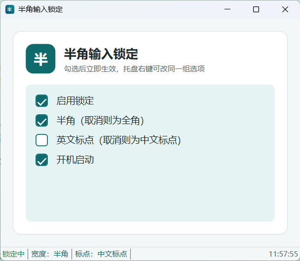
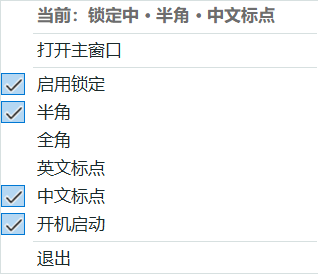

# 半角输入锁定（ImeHalfWidth）

给 **TIA Portal（博图）** 编程用的输入法辅助工具。开着微软拼音写 SCL、LAD、变量名、注释时，数字和字母经常会变成全角（如 `１`、`Ａ`）或带上中文标点，博图会报语法错误、符号无法识别、下载失败。本软件在运行期间把输入法锁在半角和英文标点，避免这类异常。

本项目采用 [MIT License](LICENSE) 开源。与 Siemens、Microsoft 无关，不修改 TIA Portal 本身。

## 作用

| 现象 | 原因 | 本软件做什么 |
| --- | --- | --- |
| 数字变成 `１２３`，字母变成 `ＡＢＣ` | 输入法处于全角 | 强制半角，数字和字母按 ASCII 输入 |
| 括号、逗号、引号变成 `（），“”` | 中文标点 | 中文输入时仍用英文标点 `(),""` |
| 变量名、DB 名、网络标题校验失败 | 混入全角字符 | 锁定后按你勾选的宽度和标点持续生效 |

主要场景：STEP 7 / WinCC 在 TIA Portal 里写程序、改符号表、画面文本。也可用于其它同样怕全角字符的编辑环境。建议勾选「启用锁定 + 半角 + 英文标点」，关窗口会缩到托盘继续锁定。

## 界面

主窗口：勾选锁定、半角/全角、中英文标点、开机启动。



关闭窗口直接缩到托盘；托盘右键显示当前状态，并可直接切换半角/全角和标点。双击托盘图标可打开主窗口，右键选「退出」才结束进程。



## 功能

- 启用或暂停锁定
- 强制半角或全角
- 中文输入时使用英文标点或中文标点
- 开机启动
- 系统托盘常驻；右键可改同一组选项，并显示当前状态
- 关闭窗口直接缩到托盘；托盘右键「退出」才结束进程
- 设置保存在用户目录，下次启动沿用

## 环境

- Windows 10 / 11（x64）
- 运行：使用系统自带的 .NET Framework 4.8，无需安装 .NET 10
- 开发：Visual Studio 2022/2026，或已安装 .NET Framework 4.8 面向包的 SDK（打开 `ImeHalfWidth.sln`）

## 使用

1. 运行 `publish\ImeHalfWidth.exe`，或自行编译后运行。
2. 勾选「启用锁定」，再选择半角/全角、英文/中文标点。
3. 关闭主窗口会缩到托盘并继续锁定。
4. 托盘图标右键可查看「当前：锁定中 · 半角 · 英文标点」并切换；选「退出」结束程序。

设置文件：

`%AppData%\ImeHalfWidth\settings.json`

开机启动写入：

`HKCU\Software\Microsoft\Windows\CurrentVersion\Run` 值 `ImeHalfWidth`

## 编译

```powershell
dotnet build ImeHalfWidth.sln -c Release
dotnet publish ImeHalfWidth.csproj -c Release -o .\publish
```

生成结果是单个小体积 `ImeHalfWidth.exe`（依赖系统自带的 .NET Framework 4.8）。

## 原理说明

程序周期性读取前台窗口的 IME 转换模式，按设置写入：

- `IME_CMODE_FULLSHAPE`：全角 / 半角
- `IME_CMODE_SYMBOL`：中文标点 / 英文标点

不注入其他进程，也不修改目标软件。效果取决于当前输入法是否响应 IMM / `WM_IME_CONTROL`。微软拼音在多数情况下可用；第三方输入法或系统更新后可能无效。

## 目录

| 文件 | 说明 |
| --- | --- |
| `MainWindow.xaml` | 主界面 |
| `ImeLockService.cs` | 输入法锁定 |
| `AppSettings.cs` | 配置读写 |
| `TrayTheme.cs` | 托盘菜单样式 |
| `Assets/App.ico` | 应用图标 |
| `images/` | README 截图 |

## 许可与声明

以 MIT 协议发布，可自由使用、修改和再分发，须保留版权与许可声明。软件按现状提供，作者不对输入法兼容性或数据损失承担责任。本项目与 Microsoft、Siemens 无关。
